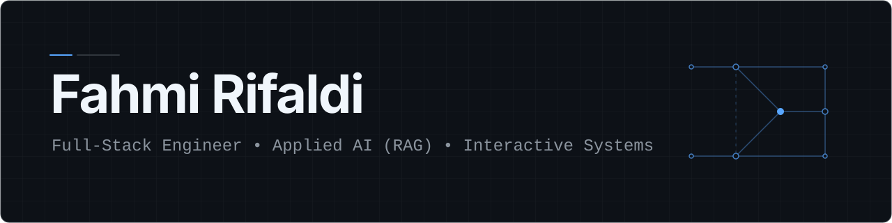
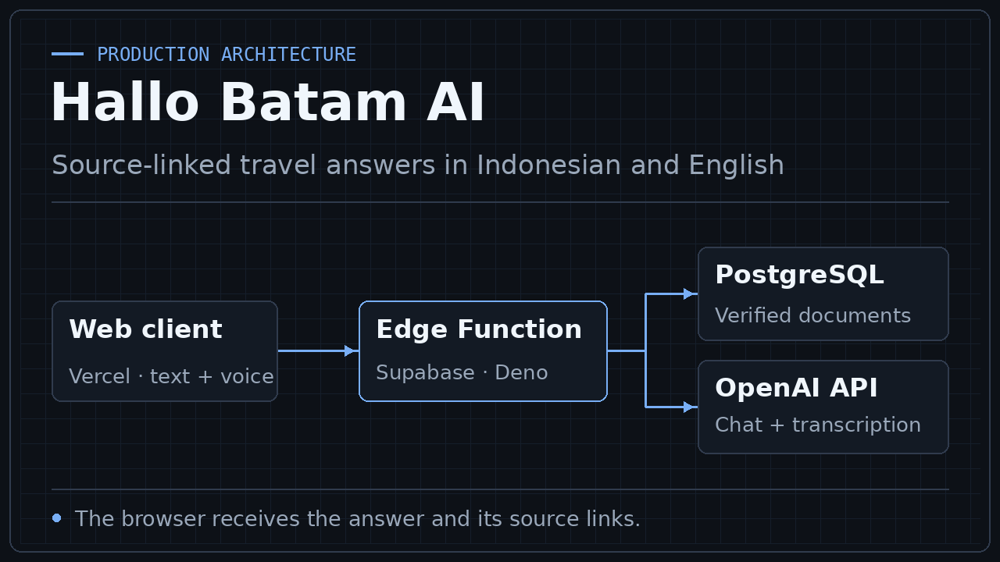
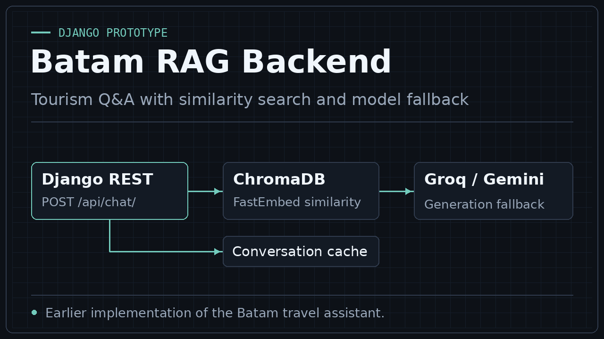
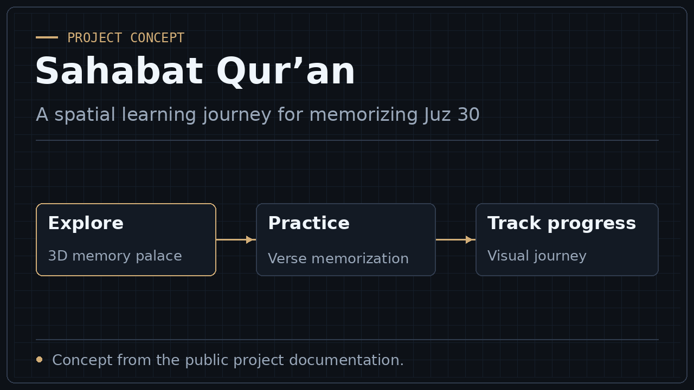
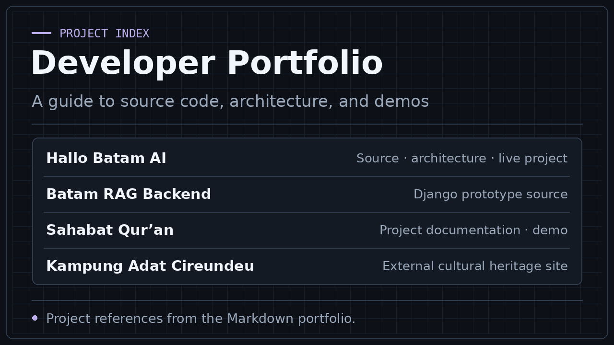

  

I build retrieval-grounded web applications, voice-enabled interfaces, and interactive learning prototypes. I focus on clear architecture and solving practical problems in information discovery and learning.

  

## What I Do

- **Full-stack and applied AI** — Build web apps that answer questions from verified sources and return links readers can check.
- **Backend systems** — Design REST APIs, retrieval workflows, and session handling, and verify build and integration contracts in CI.
- **Interactive multimedia** — Build voice-enabled web interfaces and prototype spatial learning experiences.

## Featured Engineering Work

<table>
  <tr>
    <td width="50%" valign="top">
      
      <h4><a href="https://github.com/FahmiRfld-Tech/wisatabatam">Hallo Batam AI</a></h4>
      
Bilingual travel discovery through text and voice. 
      A Supabase Edge Function retrieves verified PostgreSQL documents and uses the OpenAI API to produce source-linked answers.

      
<code>HTML</code> <code>CSS</code> <code>JavaScript</code> <code>TypeScript</code> <code>Deno</code> <code>Supabase</code> <code>PostgreSQL</code> <code>OpenAI API</code> <code>Vercel</code>

    </td>
    <td width="50%" valign="top">
      
      <h4><a href="https://github.com/FahmiRfld-Tech/wisatabatam-backend.">Batam RAG Backend</a></h4>
      
Earlier Django REST prototype for tourism Q&amp;A. 
      FastEmbed and ChromaDB power similarity search, with cached chat history and a Gemini fallback.

      
<code>Python</code> <code>Django REST Framework</code> <code>LangChain</code> <code>FastEmbed</code> <code>ChromaDB</code> <code>Groq</code> <code>Gemini</code>

    </td>
  </tr>
  <tr>
    <td width="50%" valign="top">
      
      <h4><a href="https://github.com/FahmiRfld-Tech/sahabatquran">Sahabat Qur'an</a></h4>
      
Spatial learning concept for memorizing Juz 30. 
      The public repository documents a 3D memory palace and progress rewards. The application source is unpublished.

      
<code>Markdown</code>

    </td>
    <td width="50%" valign="top">
      
      <h4><a href="https://github.com/FahmiRfld-Tech/fahmifaldi61-tech">Developer Portfolio</a></h4>
      
Documentation index for web, AI, and interactive projects. 
      A Markdown README organizes architecture notes, source links, and demos for review.

      
<code>Markdown</code>

    </td>
  </tr>
</table>

## Core Tech Stack

**Backend, AI & Data**

**Frontend, Mobile & Interactive**

**Infrastructure & Workflow**

## GitHub Activity

  
  

